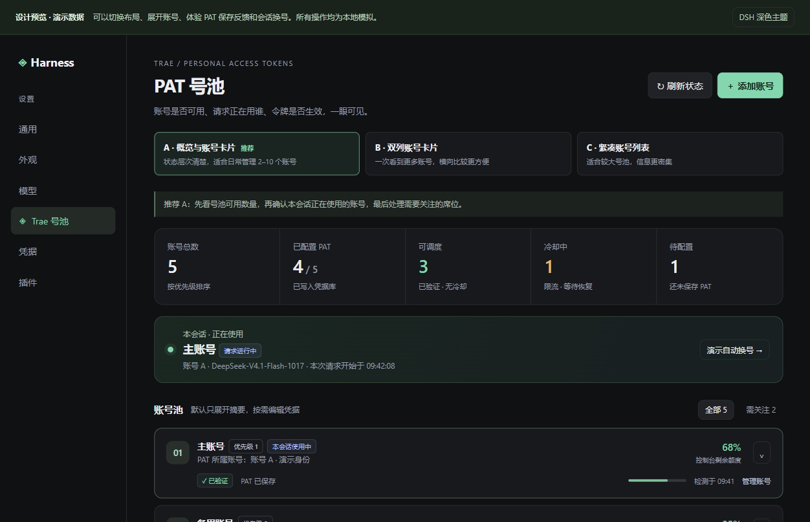

# dsh-trae-pat-pool

在 DeepSeek Harness 里直接调用 **Trae 企业模型**。一个 PAT 就能用；多个 PAT 组成号池，自动换号，并让你看清每个账号的状态与额度。



> 界面示意（演示数据）。实际账号、状态和额度以已安装插件为准。

当前版本：**v0.15.0**。

---

## 它解决什么问题

- 不用 `trae2api` 进程、Python 或 `traecli`，PAT 直连 Trae 企业模型。
- 一个 PAT 直接使用；多个 PAT 自动组成号池，默认故障转移，也可逐请求轮转。
- 明确区分“已保存”和“已验证”：哪些账号可用、哪些正在冷却、何时恢复，一眼可见。
- 对话栏显示本会话实际使用的账号；额度徽标跟随该账号，不拿主席位数字冒充当前账号。

## 界面怎么看

1. **号池概览**：账号总数、已配置、已验证可用、冷却/异常、待配置/待验证是不同维度，不相加。
2. **账号卡片**：优先级、PAT 身份、验证状态、冷却原因与额度来源；凭据默认折叠，不会回显已保存的 PAT。
3. **当前会话账号**：显示“使用中 / 上次使用 / 尚未使用”，自动换号时显示原因；多个会话各自记录。
4. **对话栏额度**：按实际使用账号读取额度；额度未知时仍保留账号标识，也不会把旧账号额度挂到新请求上。

## 三步上手

### 1. 安装插件

从 [Releases](https://github.com/Luckyre/dsh-trae-pat-pool/releases) 下载 `dsh-trae-pat-pool-0.15.0.tgz`，然后执行：

```sh
dsh plugin --profile desktop add ./dsh-trae-pat-pool-0.15.0.tgz
```

也可以在 DSH 侧栏 **插件 → 添加插件** 选择该安装包。安装后重启 DSH。

卸载：

```sh
dsh plugin --profile desktop remove dsh-trae-pat-pool
```

### 2. 添加 PAT

打开 **设置 → 左侧 Trae 号池 → 添加账号**，填入 Trae 企业控制台生成的 PAT，点击 **保存并验证**。

企业版如需查看额度，再展开该账号，填写控制台邮箱与密码。密钥只写入 DSH 凭据库，不写入配置文件。

已有 Cloud-IDE JWT（例如 `~/.trae/cli/auth.json` 的 `access_token`）也可以填入 PAT 框；JWT 过期后需要自行更新。

### 3. 使用模型

新建或打开对话，在模型菜单选择 **Trae** 分组的模型。发送消息后，对话栏会显示本次实际使用的账号；账号额度可用时，模型选择器旁显示额度徽标。

## 最常见选择

| 场景 | 怎么做 |
|---|---|
| 只有一个 PAT | 直接填一个账号，默认行为与旧版一致 |
| 有多个 PAT | 保持默认“故障转移”；想摊开额度与限流可改“逐请求轮转” |
| 企业版要看额度 | 为账号填写控制台邮箱与密码；SSO-only 租户没有这条路径 |

## 安全边界

- PAT、JWT 与控制台密码只进 DSH 凭据库；配置文件只保存引用名。
- 状态接口不返回 PAT、JWT、密码或上游原始错误正文。
- `~/.dsh/.trae-pat-pool.json` 只记录冷却结论与时间，不含凭据。
- 企业版额度认控制台账号：两个席位共用同一控制台账号会读到同一份数字；插件会提示 PAT 账号与控制台邮箱不一致。

## 更多文档

- [配置与号池模式](docs/CONFIGURATION.md)
- [开发说明](docs/DEVELOPMENT.md)
- [路线图](docs/ROADMAP.md)
- [已知限制](docs/KNOWN_LIMITS.md)
- [方案 A 验证记录](docs/superpowers/specs/2026-11-28-pat-pool-ui-verification.md)

## License

MIT · Trae 接口为未公开内部接口，上游协议变化可能导致插件失效。
